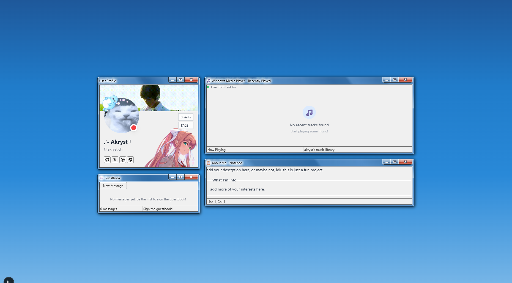

# AeroBio

A personal website with a Windows 7 Aero aesthetic.




---

## Features

| | |
|---|---|
| Profile card | Live Discord status via Lanyard WebSocket |
| Music widget | Recently played tracks from Last.fm |
| Guestbook | Anonymous messages from visitors |
| About | A section about me |
| Visitor counter | Counts unique IP addresses |

## Setup

Use Node.js 20.9 or newer.

```bash
git clone https://github.com/Akryst/Aerobio.git
cd Aerobio
npm ci
cp .env.example .env
npx prisma generate
npx prisma db push
npm run dev
```

On Windows, if Prisma reports a schema engine error while creating the default database, use Node.js 22.13+ to create the file and then retry the schema push.

```bash
node -e "new (require('node:sqlite').DatabaseSync)('prisma/dev.db').close()"
npx prisma db push
```

## Environment Variables

```env
DATABASE_URL="file:./dev.db"
ADMIN_SECRET=
TRUSTED_IP_HEADER=
SITE_URL=
LASTFM_API_KEY=
LASTFM_USERNAME=
DISCORD_ID=
```

- **Last.fm API key** — [last.fm/api/account/create](https://www.last.fm/api/account/create)
- **Discord ID** — Join the [Lanyard Discord server](https://discord.gg/lanyard), enable Discord Developer Mode, then right-click your profile and copy your user ID.
- **Admin secret** — Generate a long, random value to enable moderation.
- **Site URL** — Set to the public HTTPS origin before building for production so link previews use the public domain.
- **Trusted IP header** — Leave blank locally. Behind a reverse proxy, set this to a single-IP header the proxy overwrites on every request. For example, use `TRUSTED_IP_HEADER=X-Real-IP` with Nginx's `proxy_set_header X-Real-IP $remote_addr;`. Only the trusted proxy should be able to reach the app server. Without a trusted IP, posts share a cooldown, likes share one vote per message, and requests add no new unique IPs.

For Cloudflare Tunnel, set `TRUSTED_IP_HEADER=CF-Connecting-IP`. If `cloudflared` runs on the same host as AeroBio, bind AeroBio to `127.0.0.1` and set the tunnel's service URL to `http://127.0.0.1:3000`. Visitors should use the tunnel hostname so they cannot bypass Cloudflare and supply their own IP header. [Cloudflare HTTP headers](https://developers.cloudflare.com/fundamentals/reference/http-headers/#cf-connecting-ip)

## Admin Mode

Open `/admin`, select the message, then enter your moderation key to confirm removal. Rotate any key previously used in a URL.

## Deployment

Back up the SQLite database before updating an existing installation. Apply the schema to add vote tracking before starting the new build. The existing message totals and visitor records are kept.

```bash
npm ci
npx prisma generate
npx prisma db push
npm run build
npm start
# or
pm2 start ecosystem.config.js
```

After building, run the guestbook regression test with Node.js 22.13+ using `node --test tests/guestbook.test.mjs`. It creates its own disposable SQLite database.

## Credits

- [7.css](https://github.com/nicepkg/7.css) — Windows 7 UI kit
- [Lanyard](https://github.com/Phineas/lanyard) — Discord rich presence API
- [Last.fm API](https://www.last.fm/api) — Music scrobbling data
- [schuh.wtf](https://schuh.wtf/) — Inspo for vibes and design

---

MIT License
